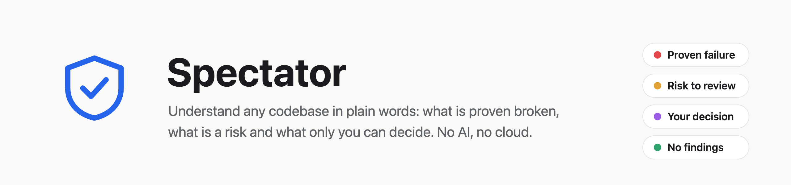
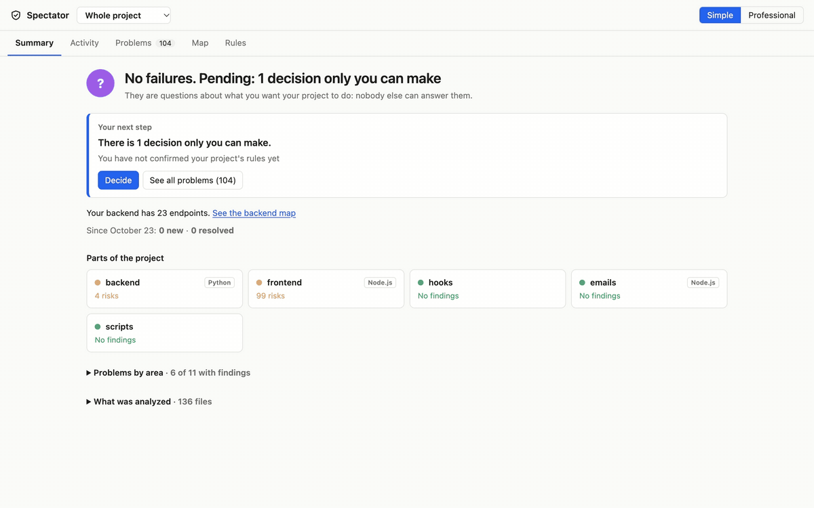
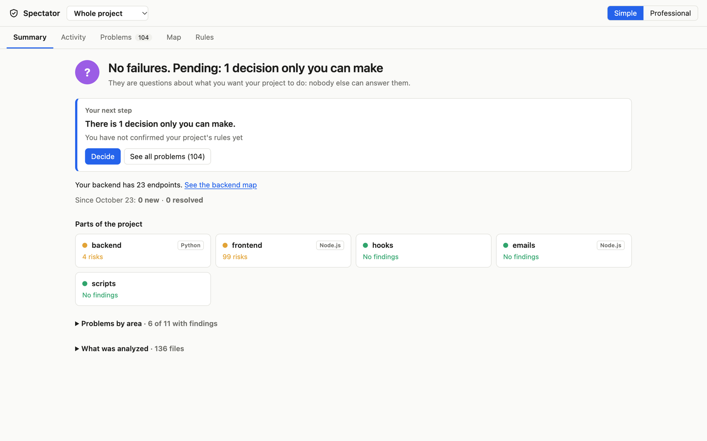
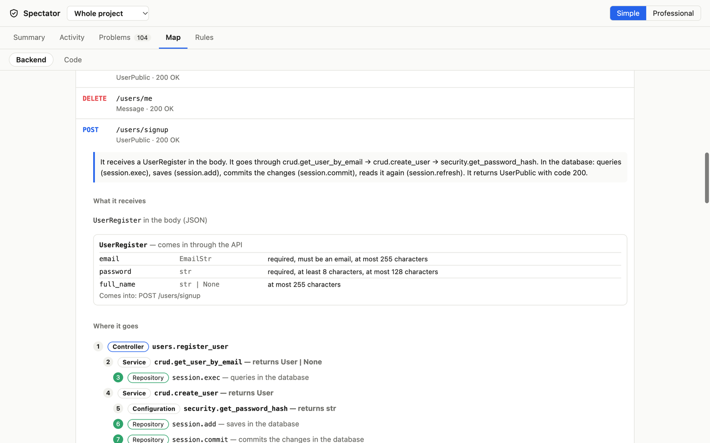
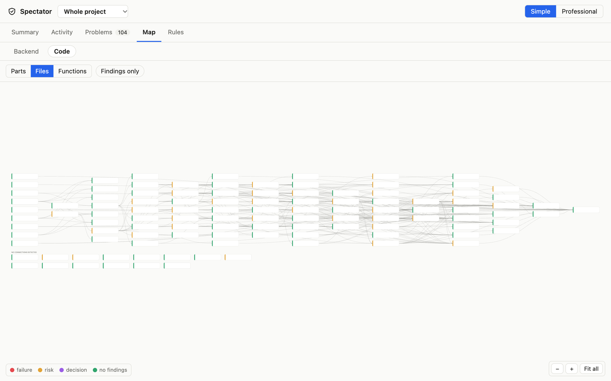
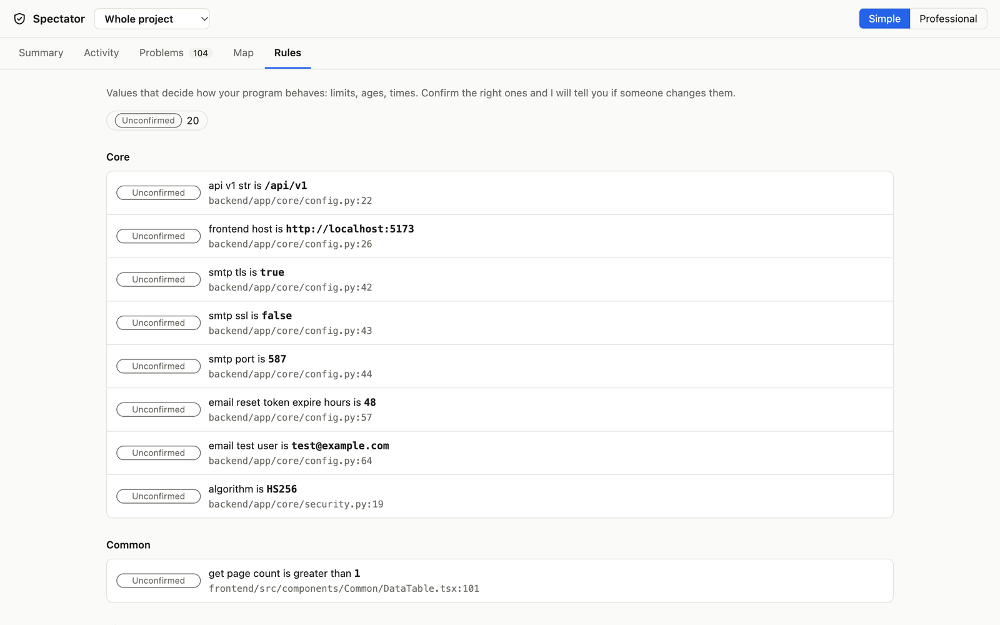
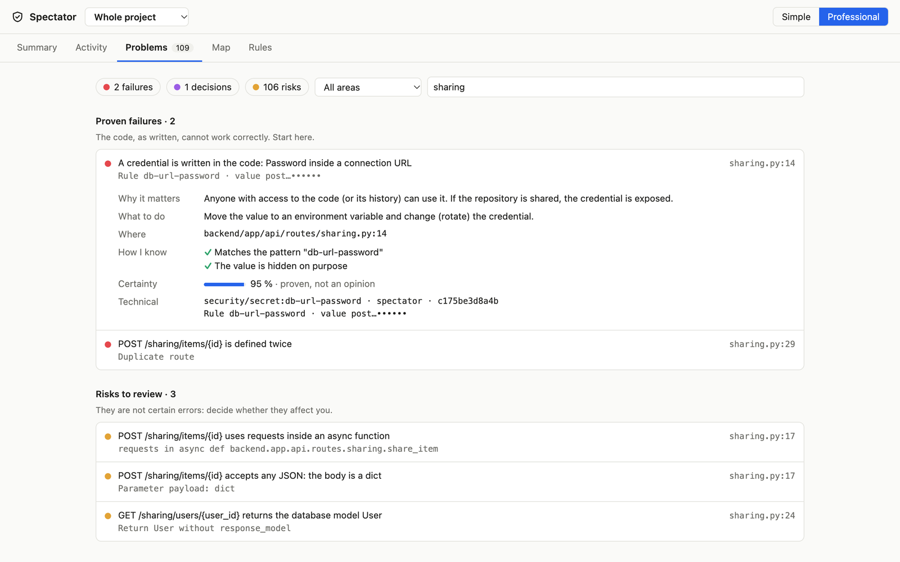
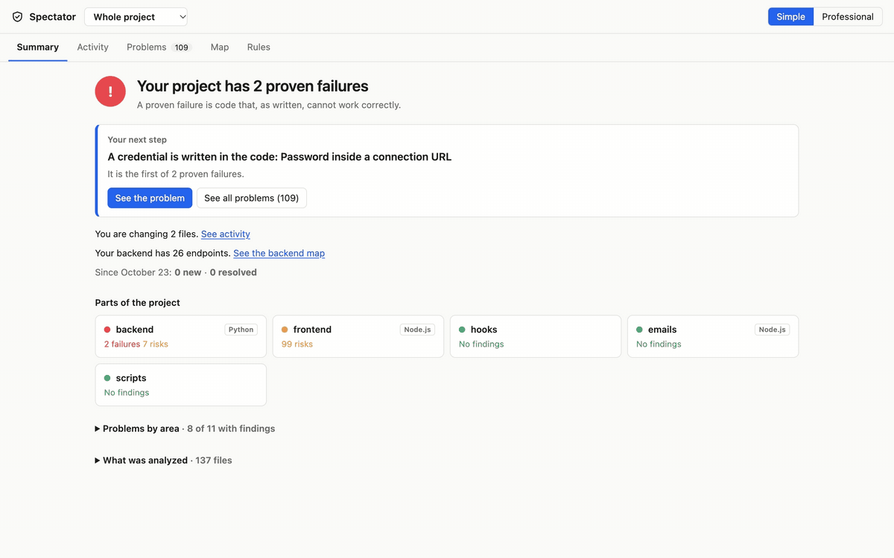
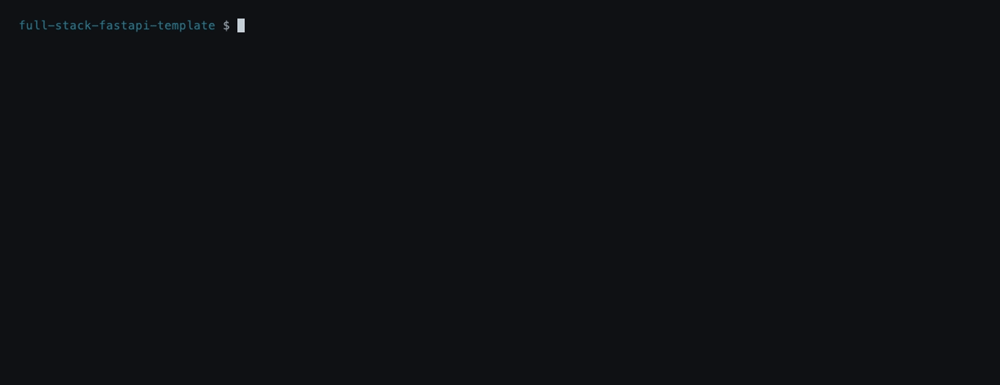
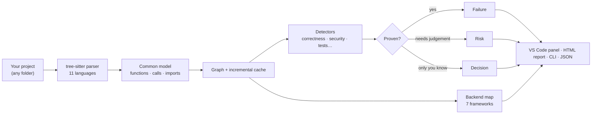

<picture>
  <source media="(prefers-color-scheme: dark)" srcset="assets/banner-dark.png">
  
</picture>

<div align="center">

**A VS Code extension and CLI that explains your project back to you, in plain words.**

It reads your code, maps your backend endpoint by endpoint and sorts every finding into
*proven failure*, *risk* or *a decision only you can make*. Same input, same result: no AI, no account, nothing leaves your machine.

[](https://github.com/SekaiBuilder/spectator/actions/workflows/ci.yml)
[](https://github.com/SekaiBuilder/spectator/releases/latest)


[Install](#install) · [What it shows](#what-it-shows) · [Catching AI mistakes](#catching-the-mistakes-ai-makes) · [Terminal and CI](#in-the-terminal-and-in-ci) · [Try it yourself](#try-it-on-a-real-project) · [Contributing](#contributing)

</div>

<p align="center">
  
</p>
<p align="center"><sub>Real analysis, no edits: the official <a href="https://github.com/fastapi/full-stack-fastapi-template">FastAPI full-stack template</a>,
136 files, Python + React, 23 endpoints, analyzed in under half a second.</sub></p>

---

## Why Spectator

AI assistants write code faster than anyone can read it. Linters answer "is this line OK?".
Spectator answers the questions that come before that:

- **What is in this project?** Its parts, its endpoints, the data that comes in and goes out.
- **What is actually broken?** Only things that can be shown from the code are called *failures*.
- **What should I look at?** Everything else is a *risk* with a reason, a fix and the exact line.
- **What only I can decide?** Values like limits, timeouts and roles are rules you confirm once.
  If anyone (or any AI) changes them later, Spectator tells you.

It works the same on code written by hand, by an AI, or inherited from someone else.

## Install

**VS Code extension.** Download `spectator-0.12.1.vsix` from the
[latest release](https://github.com/SekaiBuilder/spectator/releases/latest), then in VS Code open
*Extensions → … → Install from VSIX*. Open any folder and click the shield in the activity bar.

**From source** (Node.js 20+), for the CLI or to hack on it:

```bash
git clone https://github.com/SekaiBuilder/spectator.git
cd spectator
npm install
node src/cli.js scan examples/restaurante --html   # a small project with bugs on purpose
npm run package                                     # build your own .vsix
```

## What it shows

### Summary: one answer and your next step



The first screen answers one question: *what do I do now?* Each part of the project
(here `backend`, `frontend`, `emails`…) is detected from its manifest and gets its own status.
On this well-kept template the honest answer is **no proven failures**, 103 risks to review and one decision.

### Backend map: every endpoint in plain words



Pick an endpoint and read what it does: what it receives, which rules each field follows,
every step from the controller to the database, what it returns, what happens when it fails,
and a ready-to-copy `curl` request.
Works with **FastAPI, Flask, Django / DRF, Express, NestJS, Next.js and Spring Boot**.

### Code map: the whole project at a glance



Three zoom levels on the same map: **parts → files → functions**. Each connection says whether it is
an import, a call or only a type with the same name. *Findings only* hides everything that is clean.

### Rules: the values that drive your app



Spectator finds the values that decide behaviour (`EMAIL_RESET_TOKEN_EXPIRE_HOURS = 48`, `ALGORITHM = "HS256"`…).
Confirm the right ones and any later change shows up as a conflict, with the file and line.

### Simple or Professional

One toggle decides how much you see. **Simple** keeps the essentials and the next step.
**Professional** adds rule IDs, evidence, certainty, filters and full paths.



## Catching the mistakes AI makes

To show what a failure looks like, we took the same template and added **one endpoint the way an AI assistant
often writes it**: a hardcoded database password, a route defined twice, a blocking HTTP call inside `async`,
a request body typed as a bare `dict` and a database model returned straight to the client.
The planted file is in [`demo/sharing.py`](demo/sharing.py).

<p align="center">
  
</p>

Spectator flagged all five. The two that can be shown from the code are **proven failures**.
The three that depend on context are **risks**. Each one says why it matters, what to do and where.

<details>
<summary><b>What it looks for in AI-written backends</b></summary>

| Framework | Typical mistakes detected |
|---|---|
| FastAPI / Flask | Body without validation, database model returned as-is, blocking call inside `async`, duplicate route |
| Django / DRF | URL pointing to a view that does not exist, `save()` without `is_valid()`, `.objects.get()` without "does not exist" handling, `fields = "__all__"` exposing the password, `@csrf_exempt`, `DEBUG = True` with `ALLOWED_HOSTS = ["*"]` |
| Express / NestJS / Next.js | `req.body` without `express.json()`, unhandled `async` errors in Express 4, lookup by id without a 404, missing `ValidationPipe`, server secret used in the browser |
| Spring Boot | `@Query` using an attribute that does not exist, `@RequestBody` without `@Valid`, `findById(...).get()`, controller returning an `@Entity`, eager `@ManyToOne` |
| Any language | Hardcoded credentials, SQL built by concatenation, tests that assert nothing, dead code, duplication, import cycles |

</details>

## In the terminal and in CI

<p align="center">
  
</p>

The same engine runs without VS Code (the GIF uses an alias, `spectator`, for `node src/cli.js`). `spectator scan` exits with **1 when there are proven failures**,
so it can gate a pull request. `--html` writes a self-contained report, the same pages you see in the editor.

```bash
node src/cli.js scan [folder] [--html] [--json] [--new] [--baseline]
node src/cli.js backend [folder]                      # endpoint-by-endpoint backend map
node src/cli.js api --target http://localhost:8000    # watch calls to your API and explain each error
```

## Live in the editor

Inside VS Code, Spectator also watches what happens while you work:

- **Timeline**: every file changed today, when, and whether Claude Code or Codex changed it (read from their local logs; only paths, times and the changed fragment, never the conversation).
- **API and logs**: a local proxy explains every call to your API (500, 404, 422…) and links the error in your log to the file and line.
- **Running app**: starts your Spring Boot or Express app, probes its endpoints and reports crashes, 500s instead of 404s and updates that are never saved.
- **Works next to IntelliJ** or any other editor: it sees changes made outside VS Code.

## Try it on a real project

Everything on this page can be reproduced in a few minutes.

```bash
git clone https://github.com/fastapi/full-stack-fastapi-template.git
cd full-stack-fastapi-template
```

1. [Install Spectator](#install).
2. Open the folder in VS Code and click the shield in the activity bar.
3. Spectator reports that 4 generated files were not analyzed. Click *Leave out 4 generated or oversized files*, or add this `spectator.json`:

   ```json
   { "exclude": ["frontend/src/client/**", "backend/app/email-templates/**"] }
   ```
4. To see failures, copy [`demo/sharing.py`](demo/sharing.py) into `backend/app/api/routes/` and register it as shown in [`demo/main.py.diff`](demo/main.py.diff).

The captures on this page come from commit `b1125d8` of the template (15 October 2026).

## How it works



- **Deterministic.** No model, no sampling: the same code always gives the same result, and the evidence is one click away.
- **Local.** The engine runs in a separate Node process. Nothing is uploaded; detected secrets are masked in every report.
- **Incremental.** After the first scan, editing one file re-analyzes only what depends on it.
- **Optional sensors.** A deep scan adds `npm audit`, `gitleaks` and `osv-scanner` when they are installed.

| | |
|---|---|
| **Languages** | JavaScript, TypeScript / TSX, Python, Java, Kotlin, Swift, Go, C#, Rust, PHP, Ruby, plus `<script>` blocks in `.vue`, `.svelte` and `.html` |
| **Backend maps** | FastAPI, Flask, Django / DRF, Express, NestJS, Next.js, Spring Boot |
| **Live run** | Node.js (function-level activity), Spring Boot and Express (API probing) |
| **Interface** | English, Spanish, Japanese |

## Honest limits

Spectator says what it can show and labels the rest. Before trusting it, know that:

- **"No findings" means "nothing detected in what was analyzed"**, never "correct". Skipped files are always listed.
- It is **static analysis**: reflection, metaprogramming and values that only exist at runtime can hide connections.
- Security rules prove a **pattern exists**, not that it is exploitable.
- JS/TS and Python are the most tested. Other languages resolve calls by name within the same language.
- It is a **beta** and not yet on the VS Code Marketplace. The English and Japanese texts have not been reviewed by a native speaker.

Found something wrong? [Open an issue](https://github.com/SekaiBuilder/spectator/issues/new/choose): false positives are bugs.

## Contributing

Spectator is open source under the [Apache License 2.0](LICENSE). Contributions are welcome, especially:

- **False positives and missed problems**, with the smallest snippet that reproduces them.
- **New frameworks** for the backend map, following the projects with known answers in [`examples/`](examples/).
- **Better English and Japanese** texts in [`src/core/catalog.js`](src/core/catalog.js).

Start with [CONTRIBUTING.md](CONTRIBUTING.md). Security issues go through [SECURITY.md](SECURITY.md). Changes per version are in [CHANGELOG.md](CHANGELOG.md).

---

<sub>Screenshots show the official FastAPI full-stack template (MIT) analyzed by Spectator. FastAPI is a project by Sebastián Ramírez; Spectator is not affiliated with it.</sub>
